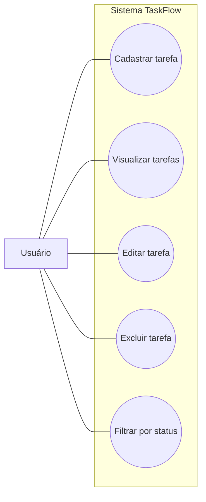

# Diagrama de Casos de Uso

O diagrama representa as ações disponíveis para uma pessoa que utiliza o TaskFlow. Na versão atual, não existe diferenciação entre perfis de usuário.

**Descrição:** o usuário pode cadastrar, consultar, editar e excluir tarefas. Também pode filtrar a listagem pelo status.
