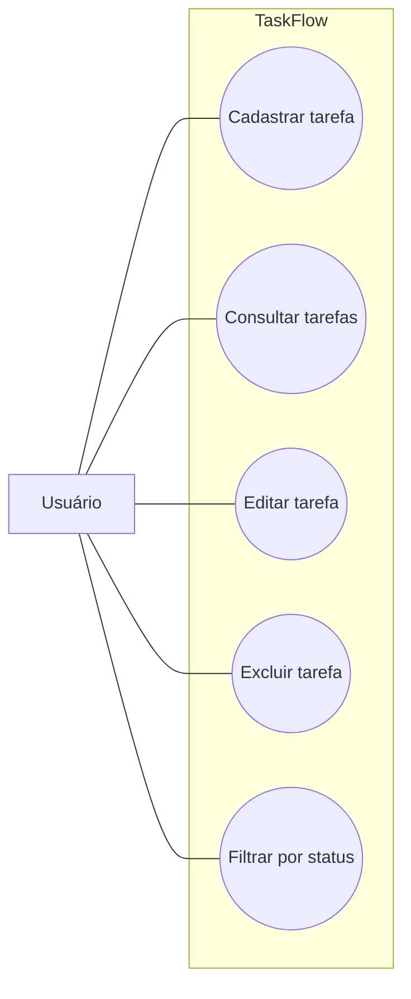

# Diagrama de Casos de Uso

## Objetivo

O diagrama apresenta as principais funcionalidades disponíveis para o usuário do TaskFlow. Como o sistema não possui diferenciação entre perfis de acesso, todas as operações são realizadas por um único ator: Usuário.

## Diagrama

## Descrição dos casos de uso

- **Cadastrar tarefa:** permite adicionar uma nova tarefa ao sistema.
- **Consultar tarefas:** permite visualizar as tarefas cadastradas.
- **Editar tarefa:** permite alterar as informações de uma tarefa existente.
- **Excluir tarefa:** permite remover uma tarefa do sistema.
- **Filtrar por status:** permite visualizar tarefas conforme seu estado, como pendente ou concluída.

## Ator

**Usuário:** pessoa responsável por utilizar o TaskFlow e gerenciar as tarefas cadastradas.

## Considerações

O diagrama representa as funcionalidades disponíveis na versão atual do sistema, considerando um único perfil de usuário.
