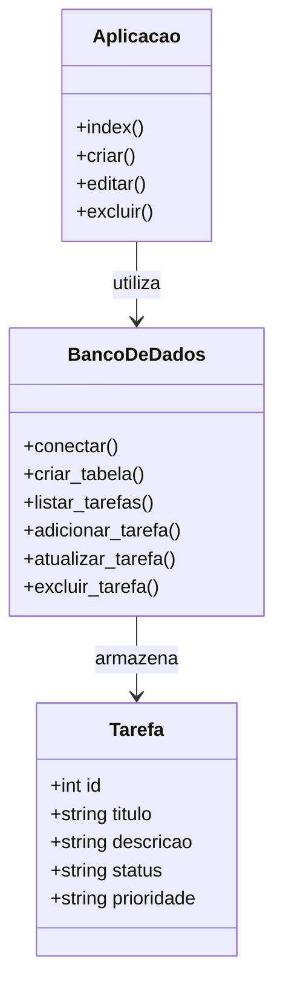

# Diagrama de Classes

## Objetivo

O diagrama representa a estrutura principal do TaskFlow, demonstrando as classes responsáveis pelas tarefas, pelo banco de dados e pelo funcionamento da aplicação.

## Diagrama

## Descrição das classes

**Tarefa:** representa uma atividade cadastrada no sistema, contendo identificador, título, descrição, status e prioridade.

**BancoDeDados:** responsável por estabelecer a conexão com o SQLite e executar operações de consulta, cadastro, atualização e exclusão de tarefas.

**Aplicacao:** responsável por receber as requisições do usuário por meio das rotas Flask e acionar as operações necessárias no banco de dados.

## Relacionamentos

- Aplicacao utiliza BancoDeDados para realizar as operações.
- BancoDeDados armazena e recupera os registros representados pela entidade Tarefa.
