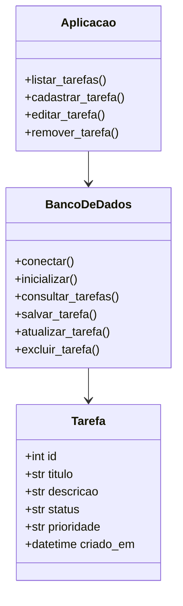

# Diagrama de Classes

O modelo abaixo representa a entidade principal persistida no banco de dados e os componentes responsáveis pelo acesso aos dados e pelas rotas da aplicação.

**Descrição:** `Tarefa` representa os dados armazenados. `BancoDeDados` concentra a conexão e as operações SQLite. `Aplicacao` recebe as solicitações feitas pelas páginas e aciona as operações necessárias.
